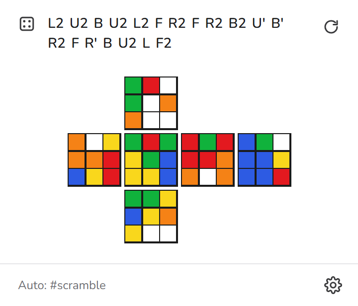
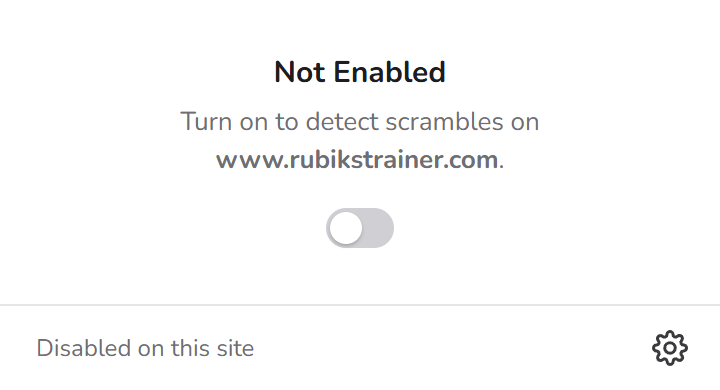
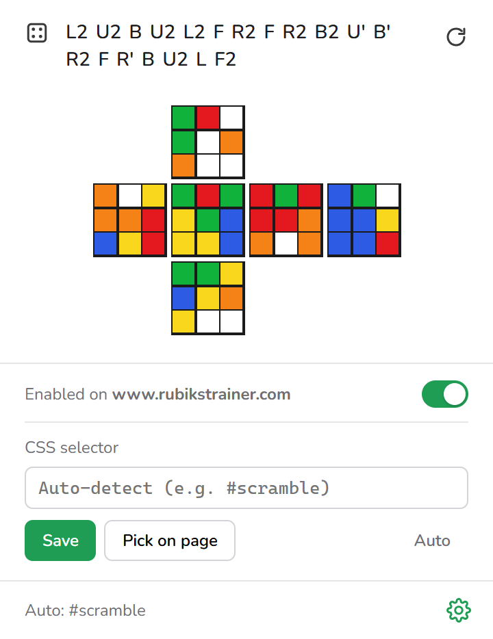

# Scramble Preview

[](https://developer.chrome.com/docs/extensions/develop/migrate/what-is-mv3)
[](#install)
[](#install)
[](#install)
[](#install)
<br />
[](cube.js)
[](manifest.json)
[](#use)
[](https://github.com/blueedgetechno/cube-scramble-preview/stargazers)
[](https://github.com/blueedgetechno/cube-scramble-preview/commits)

Preview a 3x3 scramble as an unfolded cube net using the **[hosted SVG API](#scramble-svg-api)** or the browser extension (Chrome / Brave / Edge / Firefox, Manifest V3). The net has U on top, L F R B across and D below, starting with white up and green front. Use it to check that you scrambled your cube correctly before you start solving.

The API is hosted at **https://cube.blueedge.me/api/scramble**. Pass your moves in the `algorithm` query parameter to get an SVG image, ready to embed in a website or app. **[Try an example](https://cube.blueedge.me/api/scramble?algorithm=B%20R2%20F2%20D2%20F%20L2%20D2%20F%20D2%20F2%20L2%20U)**.

The browser extension reads a scramble from the current page. For example, you can use it on [rubikstrainer.com/cross2f2l](https://www.rubikstrainer.com/cross2f2l). The scramble there is picked up automatically, with no selector needed.

To see what it does, open the live demo at **[blueedgetechno.github.io/cube-scramble-preview](https://blueedgetechno.github.io/cube-scramble-preview/)**, or open [docs/index.html](docs/index.html) in a browser. It has a demo of the popup and a scramble playground.

[](https://blueedgetechno.github.io/cube-scramble-preview/)

<p align="center">
  
</p>

| Not enabled | Settings |
| :---: | :---: |
|  |  |

## Install

1. Clone the repository (or [download it from GitHub](https://github.com/blueedgetechno/cube-scramble-preview)):
   ```sh
   git clone https://github.com/blueedgetechno/cube-scramble-preview.git
   ```
2. Open `chrome://extensions` (or `brave://extensions`, `edge://extensions`) and turn on **Developer mode**.
3. Click **Load unpacked** and select the cloned folder.
4. Pin the extension to the toolbar if you like.

**Firefox:** open `about:debugging#/runtime/this-firefox`, click **Load Temporary Add-on…** and choose `manifest.json`. Temporary add-ons are removed when Firefox restarts.

## Use

Works on sites such as [rubikstrainer.com/cross2f2l](https://www.rubikstrainer.com/cross2f2l) and other timers or trainers that show the scramble as text.

- Every site is **off by default**. Open the popup and turn on the toggle under "Not Enabled" to enable it for the current site (saved per hostname). To turn it off again, use the toggle at the top of the ⚙ settings panel.
- Once enabled, the scramble is detected automatically and the cube preview is shown. While the popup is open it re-checks the page every 1.5 s, so a new scramble shows up on its own.
- Click the scramble text to edit it by hand. Click ↻ to read it from the page again.
- Click ⚙ to set a **CSS selector** for the current site (for example `#scramble`). You can also click **Pick on page** and then click the scramble text on the page. Click **Auto** to go back to auto-detection.

Supported notation: `R U F L D B` with `'`, `2` and `3`, wide moves (`Rw`, `r`), slice moves (`M E S`) and rotations (`x y z`).

Auto-detection first looks at visible elements whose id or class contains "scramble". If none match, it uses the longest line of page text that is mostly moves.

## Scramble SVG API

**Endpoint:** `GET https://cube.blueedge.me/api/scramble?algorithm=<URL-encoded moves>`

The API applies the supplied scramble; it does not generate random scrambles.
It reuses the extension's cube model and colors and returns an
unfolded cube net with a transparent background, using white up and green front
as the starting orientation (a scramble changes the stickers, not the view).
The response is `image/svg+xml; charset=utf-8`, sized at 161 by 121 pixels,
with square corners and 1.5-pixel gaps between faces.

### Hosted example

[Open this scramble as an SVG](https://cube.blueedge.me/api/scramble?algorithm=B%20R2%20F2%20D2%20F%20L2%20D2%20F%20D2%20F2%20L2%20U):

```text
B R2 F2 D2 F L2 D2 F D2 F2 L2 U
```


Embed it directly as an image:

```html

```

For dynamic scrambles, URL-encode the algorithm:

```js
const algorithm = "R U R' U'";
const imageUrl = 'https://cube.blueedge.me/api/scramble?algorithm='
  + encodeURIComponent(algorithm);
document.querySelector('img').src = imageUrl;
```

Or download the SVG:

```sh
curl --get 'https://cube.blueedge.me/api/scramble' \
  --data-urlencode "algorithm=B R2 F2 D2 F L2 D2 F D2 F2 L2 U" \
  --output scramble.svg
```

### Parameters and responses

| Parameter | Required | Description |
| --- | --- | --- |
| `algorithm` | Yes, exactly once | Scramble notation, up to 4096 characters before URL encoding. An empty value (`?algorithm=`) returns a solved cube. |

Supported notation: `R U F L D B` with `'`, `2` and `3`, wide moves (`Rw`, `r`),
slice moves (`M E S`) and rotations (`x y z`).